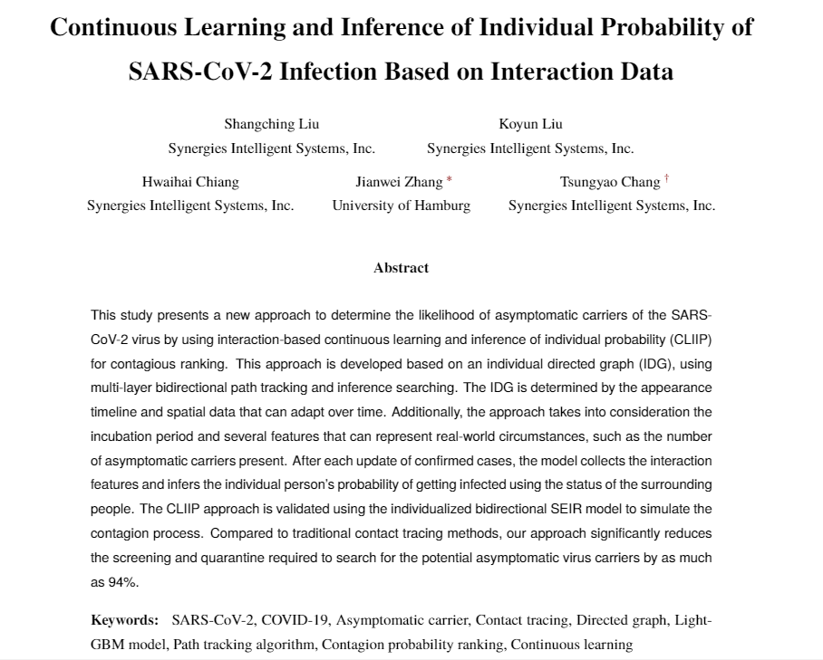
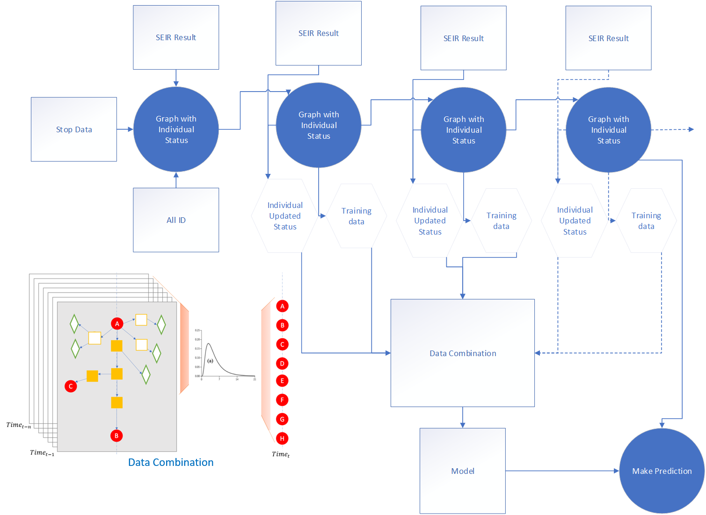

# CLIIP

Continuous learning of individual SARS-CoV-2 infection probability from interaction data.

- Paper: [arXiv:2006.04646](https://arxiv.org/abs/2006.04646) · Scientific Reports 11, 2624 (2021), [doi:10.1038/s41598-021-81809-0](https://doi.org/10.1038/s41598-021-81809-0)

## Project workflow

1. `(data → pickle_data) → stop_data → model_G` (build the interaction graph; some data are under protection)
2. `simu → SEIR`

Then: `SEIR + model_G → training_data_example` — LightGBM on a partial data split → result.

